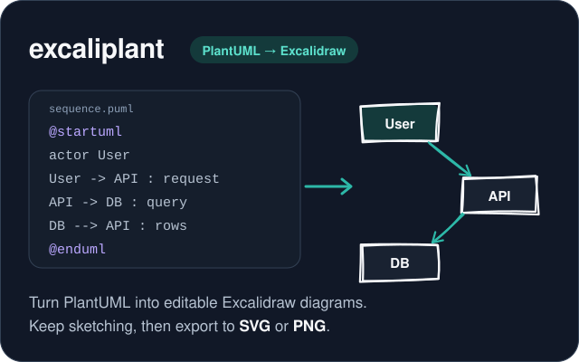
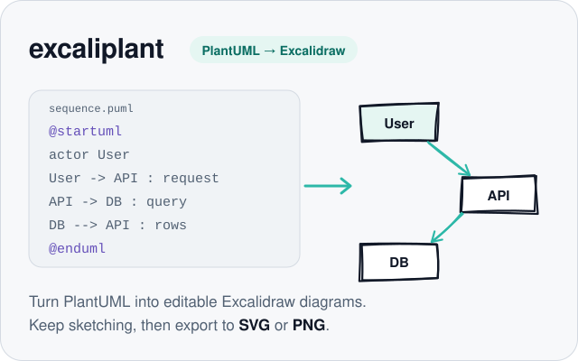
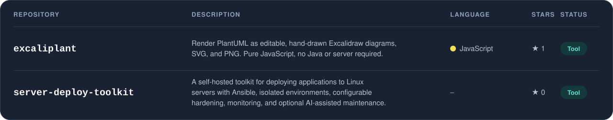
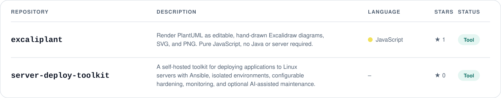
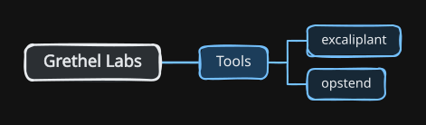
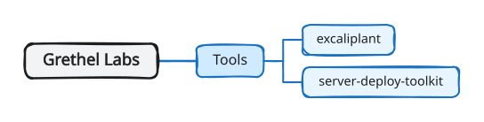

<!-- Grethel Labs · organization profile. Assets are generated by profile/assets/build_profile_assets.py from brand-kit/svg/master-paths.json. -->

## Tools

<table>
  <tr>
    <td width="50%" valign="top">
      
    </td>
    <td width="50%" valign="top">
      
    </td>
  </tr>
</table>

## Repositories

Tools are maintained and documented. Experiments are exploratory and may break. This list is generated from the public repositories of the organization.

<!-- repos:start -->

[excaliplant](https://github.com/grethel-labs/excaliplant) · [server-deploy-toolkit](https://github.com/grethel-labs/server-deploy-toolkit)

Lab map

Generated from the repository list and rendered with <a href="https://github.com/grethel-labs/excaliplant">excaliplant</a>.

<!-- repos:end -->

## Contributing

Open an issue in the matching repository for bugs and ideas. Small, focused pull requests are welcome.

The logo, theme and background files live in the [brand kit](https://github.com/grethel-labs/.github/tree/main/brand-kit).
