<!-- Grethel Labs · organization profile. Assets are generated by profile/assets/build_profile_assets.py from brand-kit/svg/master-paths.json. -->

<p align="center">
  <picture>
    <source media="(prefers-color-scheme: dark)" srcset="https://raw.githubusercontent.com/grethel-labs/.github/main/profile/assets/hero-dark.svg">
    
  </picture>
</p>

<p align="center">
  <a href="#featured"><b>Featured</b></a>&nbsp;&nbsp;·&nbsp;&nbsp;
  <a href="#index"><b>Lab index</b></a>&nbsp;&nbsp;·&nbsp;&nbsp;
  <a href="#workflow"><b>How it works</b></a>&nbsp;&nbsp;·&nbsp;&nbsp;
  <a href="#principles"><b>Principles</b></a>&nbsp;&nbsp;·&nbsp;&nbsp;
  <a href="#brand"><b>Brand</b></a>
</p>

<p align="center">
  <a href="https://github.com/orgs/grethel-labs/repositories"></a>
  <a href="#index"></a>
</p>

<br>

<a name="featured"></a>
<picture>
  <source media="(prefers-color-scheme: dark)" srcset="https://raw.githubusercontent.com/grethel-labs/.github/main/profile/assets/section-projects-dark.svg">
  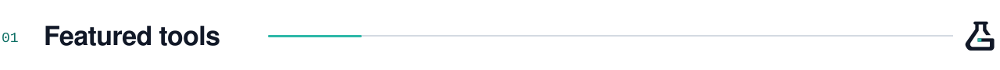
</picture>

<table>
  <tr>
    <td width="50%" valign="top">
      <a href="https://github.com/grethel-labs/excaliplant">
        <picture>
          <source media="(prefers-color-scheme: dark)" srcset="https://raw.githubusercontent.com/grethel-labs/.github/main/profile/assets/card-excaliplant-dark.svg">
          
        </picture>
      </a>
      <p align="center">
        <a href="https://github.com/grethel-labs/excaliplant/stargazers"></a>
        <a href="https://github.com/grethel-labs/excaliplant/commits"></a>
        
      </p>
    </td>
    <td width="50%" valign="top">
      <a href="https://github.com/grethel-labs/server-deploy-toolkit">
        <picture>
          <source media="(prefers-color-scheme: dark)" srcset="https://raw.githubusercontent.com/grethel-labs/.github/main/profile/assets/card-server-deploy-toolkit-dark.svg">
          
        </picture>
      </a>
      <p align="center">
        <a href="https://github.com/grethel-labs/server-deploy-toolkit/stargazers"></a>
        <a href="https://github.com/grethel-labs/server-deploy-toolkit/commits"></a>
        
      </p>
    </td>
  </tr>
</table>

<details>
<summary><b>How excaliplant works</b></summary>
<br>

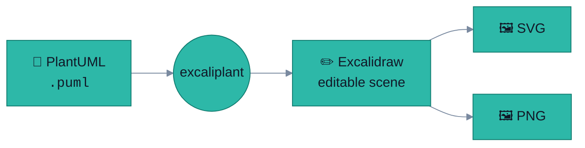

</details>

<br>

<a name="index"></a>
<picture>
  <source media="(prefers-color-scheme: dark)" srcset="https://raw.githubusercontent.com/grethel-labs/.github/main/profile/assets/section-index-dark.svg">
  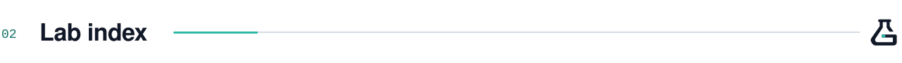
</picture>

Everything in the lab, at a glance. **Tools** are maintained and documented. **Experiments** are explorations: useful, interesting, and allowed to break.

<!-- Add a row per repository. Status badges: Tool → ...-Tool-2DB8A8..., Experiment → ...-Experiment-FFC53D... -->
| Repository | What it does | Status |
|---|---|---|
| [**excaliplant**](https://github.com/grethel-labs/excaliplant) | Turns PlantUML into editable Excalidraw diagrams, exports SVG or PNG |  |
| [**server-deploy-toolkit**](https://github.com/grethel-labs/server-deploy-toolkit) | Deploys applications to your own Linux servers with Ansible |  |
| *your next idea* | Experiments start here |  |

<a href="https://github.com/orgs/grethel-labs/repositories">
<picture>
  <source media="(prefers-color-scheme: dark)" srcset="https://raw.githubusercontent.com/grethel-labs/.github/main/profile/assets/bench-dark.svg">
  
</picture>
</a>

<br>

<a name="workflow"></a>
<picture>
  <source media="(prefers-color-scheme: dark)" srcset="https://raw.githubusercontent.com/grethel-labs/.github/main/profile/assets/section-workflow-dark.svg">
  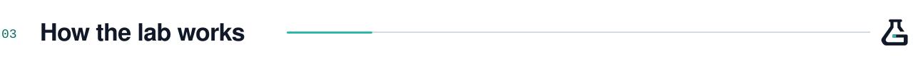
</picture>

<picture>
  <source media="(prefers-color-scheme: dark)" srcset="https://raw.githubusercontent.com/grethel-labs/.github/main/profile/assets/workflow-dark.svg">
  
</picture>

<br><br>

<a name="principles"></a>
<picture>
  <source media="(prefers-color-scheme: dark)" srcset="https://raw.githubusercontent.com/grethel-labs/.github/main/profile/assets/section-principles-dark.svg">
  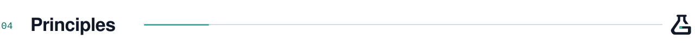
</picture>

<picture>
  <source media="(prefers-color-scheme: dark)" srcset="https://raw.githubusercontent.com/grethel-labs/.github/main/profile/assets/principles-dark.svg">
  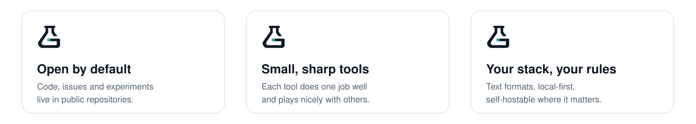
</picture>

<br><br>

<a name="brand"></a>
<picture>
  <source media="(prefers-color-scheme: dark)" srcset="https://raw.githubusercontent.com/grethel-labs/.github/main/profile/assets/section-brand-dark.svg">
  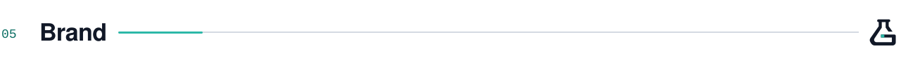
</picture>

The flask-G joins the lab with the first letter of the name. Three colours carry the whole system:

<p>
  
  
  
</p>

<details>
<summary><b>Open the brand kit</b></summary>
<br>

| | What | Where |
|---|---|---|
| 🧪 | Logos, signets, wordmarks, avatars, banners as true vector SVG | [`brand-kit/svg`](https://github.com/grethel-labs/.github/tree/main/brand-kit/svg) |
| 🎨 | Light and dark theme: CSS variables (`--gl-*`) and resolved tokens | [`brand-kit/theme`](https://github.com/grethel-labs/.github/tree/main/brand-kit/theme) |
| 🖼️ | Ambient and technical-grid backgrounds, incl. 4K | [`brand-kit/backgrounds`](https://github.com/grethel-labs/.github/tree/main/brand-kit/backgrounds) |
| 📐 | Brand guidelines and diagram-theme notes | [`brand-kit/docs`](https://github.com/grethel-labs/.github/tree/main/brand-kit/docs) |

```css
@import url("grethel-theme.css");
body    { background: var(--gl-bg-canvas); color: var(--gl-text-primary); }
.button { background: var(--gl-accent-solid); color: var(--gl-accent-foreground); }
```

</details>

> [!TIP]
> Found a bug, have an idea for an experiment, or want to help harden one into a tool? Open an issue in the matching repository. Small, focused pull requests are welcome.

<br>

<p align="center">
  <picture>
    <source media="(prefers-color-scheme: dark)" srcset="https://raw.githubusercontent.com/grethel-labs/.github/main/profile/assets/footer-dark.svg">
    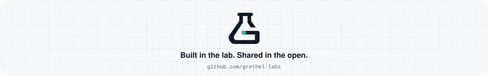
  </picture>
</p>
